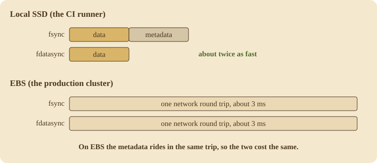

Narad's comparison page has been bugging me for a while. It only compared features, so it was basically a table of checkmarks showing which brokers support what. That's fine as far as it goes, but it dodges the questions people actually ask when they're picking a message broker: how fast is it, how much data can it lose, and what does it cost to keep running. I finally sat down and spent a day trying to answer those for Narad, and I learned a lot more than I expected to, mostly about things I'd got wrong.

## Published benchmarks don't agree with each other

I started by reading other people's benchmarks, which is where I learned why nobody trusts benchmarks.

Confluent published a benchmark in 2020 that has Kafka at 605 MB/s and Pulsar at 305 MB/s. StreamNative then published a response where the two are roughly equal. Neither is lying. The whole difference comes from one setting. By default Kafka doesn't fsync a message to disk before acknowledging it; it relies on replication and the OS page cache for durability, and `log.flush.interval.messages` defaults to `Long.MAX_VALUE`, so it just never flushes on its own. Pulsar, on the other hand, fsyncs its journal before every ack. So Confluent was comparing Kafka without fsync against Pulsar with fsync, and once StreamNative configured both to do the same thing the gap mostly went away.

Once I saw that, I couldn't unsee it, and it ended up shaping the whole comparison. A throughput number on its own doesn't tell you much unless you also know what the broker is promising when it acks. NATS JetStream, for example, fsyncs on a two-minute interval by default, and the Jepsen analysis from December 2025 found that it could lose acknowledged writes even with three-way replication, because the Raft quorum acks from memory. Redis with the default AOF policy can lose up to a second of writes. If you go through the list and ask which brokers fsync before acking with their default settings, you end up with Pulsar, RabbitMQ quorum queues, and Narad, and that's about it.

## Running a Jepsen-style test myself

I can't afford an actual Jepsen engagement, but the approach itself isn't magic, so I added a history checker to Narad's soak test harness. It uses [porcupine](https://github.com/anishathalye/porcupine), which is a linearizability checker written in Go. The harness records every produce, delivery, and ack with timestamps, and then porcupine checks each message's history against a simple sequential model of a lease queue: a message is produced, delivered, redelivered if the lease runs out, and acked once, and after the ack nothing else should ever happen to it.

One thing porcupine does well here is reason about time intervals. If an ack succeeded, the lease must have been alive at that moment, which means an ack followed by a later redelivery can't be explained away by any ordering the timestamps allow. So when it flags something, it's not a heuristic, it's an actual violation of the model.

I ran this against the live cluster and started killing pods while it was going.

The run lasted sixteen minutes at about a hundred messages a second, spread across three delivery paths, with two pod kills, one of which was the Raft leader. Across 250,680 message histories it found zero lost messages, zero early deliveries, zero protocol violations, and 941 messages that got redelivered after they had already been acked. All 941 of those were inside the two crash windows. There were none during the quiet stretches.

That's what the docs say should happen. Narad is at-least-once, a crash can bring back state that was already acked, and consumers are supposed to be idempotent. Still, writing that in the docs and having a checker actually confirm it are different things, and I was relieved to see that the duplicates only showed up where the contract allows them. Outside the crash windows, exactly-once-after-ack held across a quarter million messages.

## Throughput on the same hardware

Published numbers only go so far because they're all from different years on different hardware, run by people with different incentives. So I ran all of the brokers myself on the same setup: one at a time in Docker with two CPUs and two gigabytes of memory, same driver, same workload. Each produce waits for the broker's per-message confirmation, and then everything gets consumed and acked. Every broker was on its default durable configuration, with the caveats listed in the table.

| system | produce msg/s | the ack means |
| ------ | ------------- | ------------- |
| NATS JetStream | 39,525 | no fsync (2-min interval) |
| Redis Streams | 31,643 | AOF buffer, ~1s window |
| Kafka | 14,728 | page cache, no fsync |
| RabbitMQ quorum | 13,014 | **fsynced** |
| Pulsar standalone | 7,632 | fsync disabled in standalone |
| Narad | 5,597 | **fsynced** |

The order is mostly just the durability column. The brokers that don't flush before confirming are at the top, which is the trade-off you'd expect.


The row I kept looking at was RabbitMQ. It makes the same promise Narad does, an fsync before the confirm, and it was still producing about 2.3x faster.

## Reading RabbitMQ's source

RabbitMQ is open source, so I went and looked at how they do it. Quorum queues are built on their Raft library, Ra, and the relevant piece is a single Erlang file, `ra_log_wal.erl`. There's one shared write-ahead log per node, with group commit: each flush writes out whatever arrived while the previous flush was in progress. That's the same design Narad uses for its ingress WAL, which was reassuring and a little annoying at the same time, because it meant the gap wasn't in the design. The difference turned out to be a single configuration line, `sync_method: datasync`. RabbitMQ calls `fdatasync`, and I was calling `fsync`.

I had always treated those two as interchangeable, but they're not. `fsync` flushes the file's data and all of its metadata, so timestamps, inode updates, and on ext4 a journal transaction, and it does that on every group commit. `fdatasync` flushes the data and only the metadata you'd need to read that data back. For an append-only log that's all you need, and the rest of the metadata work is just overhead.

So I added a small package to Narad with one function and a build tag per platform. On Linux, the BSDs, and Solaris it calls `fdatasync(2)`. On macOS it calls `F_FULLFSYNC`, because Darwin has no fdatasync and its regular fsync doesn't force the drive cache, so the expensive option is the only honest one. On Windows it's `FlushFileBuffers`. I converted every place the broker syncs file data and left the directory fsyncs alone, since those exist specifically to persist metadata. Tests, cross-compiles, PR, merge.

I had also set up a nightly CI benchmark that day, running on free GitHub runners and checking against a committed baseline, and it came back with produce throughput going from 5,382 to 10,549 messages a second, with p99 produce latency down from 52ms to 3.5ms. Roughly double, from changing one syscall. I tagged v2.1.0, upgraded the cluster, bumped the brew formula, and started drafting this post as a success story.

## Then I benchmarked production

Before the upgrade the production cluster was doing 4,327 msg/s. After the upgrade it was doing 4,273. The p50 didn't move outside its own noise.

Both machines run Linux and both were taking the new fdatasync path, so the difference had to be in the storage underneath. The CI runner has a local SSD, where a flush takes microseconds. On that disk, fsync's metadata journal was a second physical flush, so halving the flushes halved the time. The cluster's disks are EBS volumes, and a flush on EBS is a network round trip to a replicated storage service. I ran a small microbenchmark inside the pod, alternating fsync and fdatasync call by call so neither one could get a better or worse position in the queue:

```
fsync      n=500  avg=2.995ms  p50=2.989ms
fdatasync  n=500  avg=3.005ms  p50=2.992ms
```

About three microseconds apart on a three-millisecond operation. The metadata commit is riding along inside the same round trip, so on EBS the change is a rounding error.



I was a bit deflated by this, but the microbenchmark did give me something the 2x number couldn't, which is a clear picture of where the time actually goes. That three-millisecond flush is a network round trip, and there's no syscall or WAL trick that makes it go away. On EBS, the cost of a flush is fixed, and the only thing that changes the math is how many messages you manage to fit into each one. Narad's produce API takes one message per HTTP request, so every message pays for its own flush. Kafka and RabbitMQ batch aggressively on the way in, and I think that's most of the reason they beat Narad in the table above. Their disks aren't faster than mine, their batches are just bigger.

## What I ended up with

The comparison page now answers the hard questions with sourced numbers and the caveats written out next to them. The Jepsen-style run showed that the only thing Narad does wrong is the thing the docs already say it does. The throughput table shows Narad losing several comparisons, fairly, with enough context that you can see what each winner gave up to get there. The release doubles throughput on local disks, does nothing on cloud volumes, and costs nothing either way. And I now know, with numbers, that the remaining cost on the cluster is the disk and not the code.

The fdatasync thing is a decade old. It's been sitting in RabbitMQ's source the whole time, one grep away, put there by people who presumably ran this same experiment years ago and watched their own EBS volumes do exactly what mine did.
