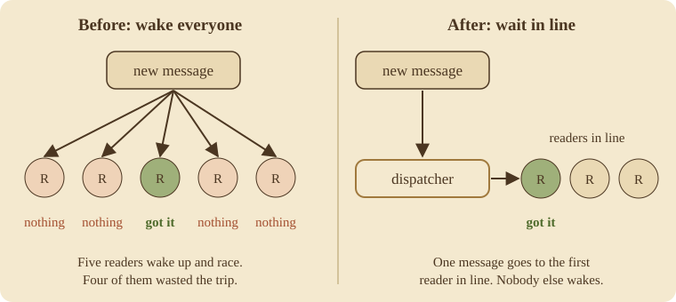
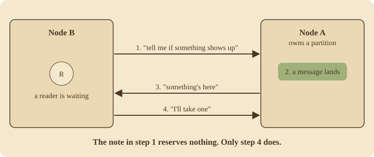
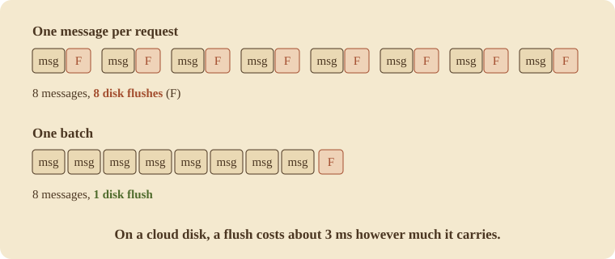
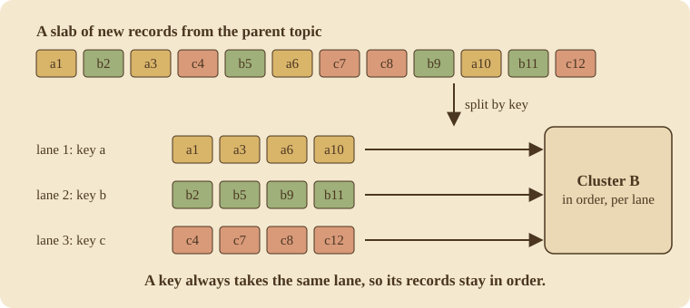

The last time I wrote about Narad, I ended on a slightly gloomy note. I had found that on cloud disks, every message paid for its own trip to the disk, and that the big brokers beat me mostly because they packed many messages into each trip. "Their disks aren't faster than mine," I wrote. "Their batches are just bigger."

That was August. Since then Narad has gone from v2 to v3.2.2, and three things happened:

1. **It got faster.** A lot faster, in places.
2. **It learned to travel.** A topic can now copy itself to a whole other Narad cluster.
3. **It took its biggest test yet** and lost nothing.

This post walks through all three. I'll keep it simple and use pictures where words get in the way.

## Part 1: Making it faster

### Waking up the right reader

When a program reads from Narad and there's nothing there yet, it doesn't give up straight away. It waits, up to a few seconds, for something to show up. Lots of readers can be waiting on the same topic at once.

The old code had a simple rule: when a new message arrives, wake up **everyone** who's waiting. They all rush in, they all look, and only one of them gets the message. The rest go back to sleep empty-handed.

With five readers that's a bit wasteful. With thousands, it's most of the work the server is doing. So now readers wait in a line. One small piece of code, the dispatcher, hands each new message to the first reader in line, and nobody else is disturbed. The cost now grows with the number of messages delivered, not with the number of readers waiting.

### Readers waiting on a different server

That fixed one server. The harder problem was readers waiting on one server for messages that land on another.

Before, a waiting reader on Node B only kept an eye on **one** other server. If the message landed anywhere else, the reader never noticed. It waited out its whole timer and went home with nothing. On a four-node cluster, I measured exactly that: **8 seconds of waiting and no message.**

The fix is a little protocol I call tokens. A server with a waiting reader leaves a note with every other server: "tell me if something shows up." When a message arrives, that server sends a quick "something's here", and the reader comes over and claims it.

The important part is that the note **reserves nothing.** If Node B crashes after leaving notes everywhere, nothing is stuck waiting for it. Only the final "I'll take one" actually reserves a message.

After this, the same test took **9 to 18 milliseconds** instead of 8 seconds. A follow-up fix removed one more delay, where each message in a slow trickle arrived about a second late. Now it's around 20 milliseconds no matter which server the message lands on.

### Going through the busy path, line by line

Next I did something I'd been putting off. I went through the three things Narad does all day (taking in a message, handing it out, and marking it done) and looked for anything slow or wrong.

That audit raised 75 suspected problems. Each one was checked by someone trying to prove it wrong, and 58 held up. **All of them are fixed**, each with a test that fails on the old code. Some were correctness bugs, which I'll come back to in another post. Many were speed:

- **Half the disk flushes.** Saving a batch of messages to a partition used to flush to disk twice. Now it flushes once, and several saves waiting on the same partition share a single flush.
- **Opening a big partition** went from about 94 milliseconds to about 0.5.
- **Saving reader progress** across 256 partitions went from almost a second to 12 milliseconds.
- **A very busy partition** now empties about 3.4 times faster, because the server stopped re-reading the same messages over and over.

### Finally: batches

And then the thing my August post was really asking for. Narad now takes **batches**: you can send, read or mark done up to 100 messages in one request. (Later, for remote children, sending went up to 1,000 messages and 16 MiB per request, optionally compressed.)

On a cloud disk, a flush costs about 3 milliseconds whether it carries one message or a hundred. So a batch of 100 pays for one flush instead of 100. Reading in batches also got faster across servers: one batch read that used to come back with a single message now brings back up to 100, about **37 times** less work per message.

### The numbers

Here's the same single-machine test from my August post (one Narad node, 2 CPUs, 2 GB of memory, one message per request), run again in October:

| | August | October |
|---|---|---|
| Messages sent per second | 5,597 | **10,454** |
| Slowest 1% of sends | 10 ms | **2.5 ms** |
| Messages read and marked done per second | 8,567 | **9,239** |

In August, Narad came last of the six brokers on sending. Now it's fifth. RabbitMQ is the only other one that also saves each message to disk before saying "got it", and its lead shrank from 2.3 times to about 1.25 times.

On a three-node cluster on Kubernetes, in October:

- **One message per request:** about 50,500 sent and 47,200 read and marked done every second.
- **Batches of 100:** **376,673 messages a second**, sustained through all three steps. Sending alone reached 623,706 a second. I counted every one of about 135 million messages, and none was missing.

One honest note: Narad keeps one copy of each partition, while some of the brokers it gets compared with keep three. That makes Narad's numbers look better next to theirs, and the [capacity page](https://debanganthakuria.github.io/narad/reference/capacity/) says so.

## Part 2: Teaching it to travel

### Why copy a topic to another cluster?

People kept asking for the same three things:

- **Move a busy topic** onto its own cluster, so it stops crowding everything else.
- **Keep a live copy in another region**, in case the first one goes down.
- **Switch over, and later switch back**, without losing messages or processing them twice.

All three need the same feature: copy every message of a topic to a topic on another Narad cluster, as it arrives. I called it **remote children.**

### Don't build a new system

Narad already had **fan-out**. You attach "child" topics to a "parent" topic, and every message sent to the parent is copied to each child. A cursor follows the parent's log and copies records across, and it only moves forward once the copy is safely saved.

So a remote child is just a fan-out child that happens to live somewhere else. It has no partitions of its own. Where a normal child saves its copy locally, a remote child hands it to a **sender**, which ships it over HTTPS to the other cluster.

This is the third time Narad has got a big feature this way: replicas in 1.0, and rebalancing in 2.0, both came from reusing something that already worked. The fan-out cursor had already survived months of testing. Remote children got all of that for free.

The rule that matters most: **the cursor only moves forward after the other cluster says `202`.** If anything goes wrong in between, the same records get sent again. So a failure can cause a duplicate, but never a gap.

### Keeping messages in order

To go fast, the sender uses several **lanes** at once. But if two messages with the same key took different lanes, the later one could overtake the earlier one. So each key always takes the same lane.

Inside a lane, records go one request at a time, in order. Records with the same key never overtake each other.

### When the other cluster is down

Clusters go down. When that happens you don't want every cursor on every server hammering the dead cluster with retries. So each server has a **gate** for each remote cluster. After a few failures the gate closes, and only one request at a time goes through as a test, waiting longer each time (from a quarter of a second up to 30 seconds). When the test gets through, the gate opens and everyone carries on from where they stopped.

Nothing is skipped while it waits. The only way a record is ever lost is if it's waiting so long that the parent topic deletes it under its retention rules, and that gets counted and alerted on.

### Keeping the passwords safe

To write to another cluster, Narad needs a username and password for it. Here's how those are handled:

- The password is **encrypted** (AES-256-GCM) before it's stored, with a key derived from the cluster's secret. Only the encrypted form is ever sent between servers.
- Each server decrypts it **once** and keeps it in memory, so sending a batch involves no extra crypto work.
- Narad only connects over **HTTPS**, never follows redirects, and refuses local and cloud-metadata addresses unless you allow them, so nobody can trick it into calling something it shouldn't.
- Before it starts, it **checks the target** to catch loops (A copies to B, and B copies back to A), chains, and a target topic that was deleted and recreated.

### How it got built

I wrote the design first and settled the open questions one at a time before writing code. Once it was built, it went through **six rounds of review**, each one looking at correctness, security, concurrency, compatibility, and what an operator would see. The rounds found 23, then 17, 16, 11, 9 and 5 problems. Every one was fixed, each with a test that failed before the fix. The number going down each round was how I knew it was getting close.

### Did it work?

On the test cluster:

- Copying a topic's whole history, **320,211 records, took about 6 seconds**, around 53,000 records a second.
- Then I broke things while it was copying: killed a source server, killed the source cluster's leader, killed **every server in the target cluster**, cut the network between them for 60 seconds, froze it for 30 seconds, and flapped it on and off. **Zero records lost** in every run.

## Part 3: What the big test found

The October test was the biggest Narad has had: about 50,000 messages a second on three servers, plus an afternoon of killing servers (one at a time, the leader, two out of three, all three at once). It lost nothing, and no message was ever handed to two readers at the same time.

It still turned up four small bugs, and they all came down to the same thing: **something reported more than it actually knew.**

- **An ack that "failed" but didn't.** Under heavy load, some acks timed out while they were already on their way, so the reader was told "failed" even though it had worked. Now Narad gives three different answers: "not applied, try again", "might have been applied", or "you went away".
- **A resume that hadn't landed yet.** Right after a remote child was resumed, asking the same server could still say "paused" for a few seconds. Now a server only says "done" once it has applied the change itself.
- **A `false` that meant "I didn't check".** One report printed `false` for a field Narad had deliberately not filled in. Now the field is simply left out.
- **My benchmark only counted five-sixths of the messages.** Its readiness check read one message and never acked it, which jammed one of the six partitions. It had been reporting the wrong numbers for at least two weeks.

All four are fixed in v3.2.2. The lesson I'm keeping: say what you know, and say when you don't.

## What's still open

- During two of the remote chaos runs, a few messages arrived at the other cluster **out of order** (36 in one run and 13 in another). Nothing was lost, and the docs say order can change during failures like these, but I haven't worked out exactly why yet.
- Partitions that were used and then went quiet still cost a little CPU each. I haven't looked into it yet.
- Under heavy load, acks seem to wait in line behind reads. I want to measure that before changing anything.

## Where to go next

Narad is on [GitHub](https://github.com/DebanganThakuria/narad). The [capacity page](https://debanganthakuria.github.io/narad/reference/capacity/) has every number and how I measured it, and the [remote children guide](https://debanganthakuria.github.io/narad/build/remote-children/) shows how to set one up. There are also step-by-step playbooks for [moving a topic](https://debanganthakuria.github.io/narad/operate/playbooks/offload/) and for [disaster recovery](https://debanganthakuria.github.io/narad/operate/playbooks/disaster-recovery/).

Two more posts go with this one. [The crab grows up](/posts/tech/the-crab-grows-up) is about the work that makes Narad trustworthy: audits, long soak tests, an outage I caused, and how correctness gets checked. [Everything the crab can do](/posts/tech/everything-the-crab-can-do) is a plain tour of every feature Narad has today.
